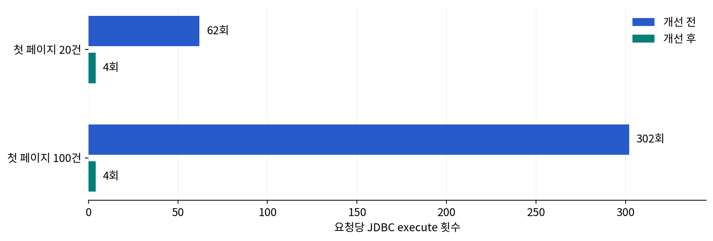
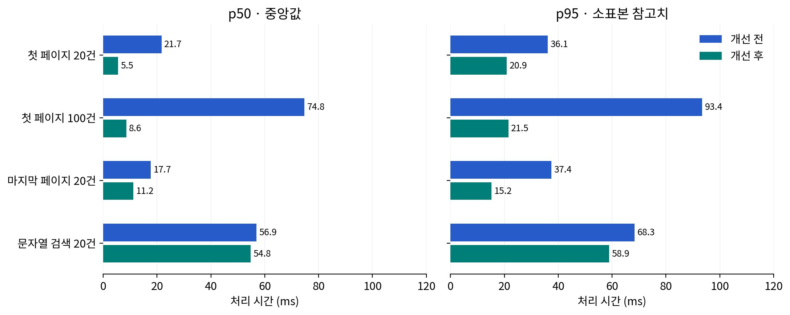
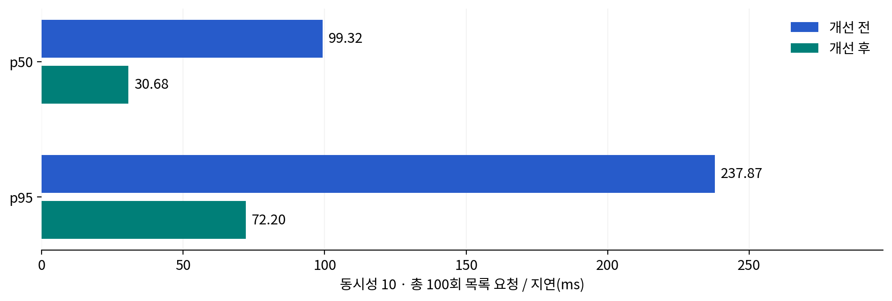

# 목록 조회 성능 개선 — 2026-11-10

첫 개선 범위는 목록의 행별 SQL 제거다. Redis/SQS·검색/지도 인덱스·문서 생성 최적화는 이번에 적용하지 않았다.

## 구현

기존은 전체 건수 + ID 목록 + 각 수용가의 기본정보·사진·검침(`2+3N`)이었다. 페이지 기본정보와 관련 ID의 사진 수·검침을 일괄 조회해 비어 있지 않은 페이지는 총4회, 빈 페이지는2회다. 상세와 공통 매핑을 사용하며 목록에는 사진 URL/메모를 추가하지 않는다. 필터·정렬·권한·날짜·금액·사용량·특이사항 응답 계약은 유지한다. Flyway 변경은 없다.

## 전후 결과

동일 가상 수용가2만 건, Java21.0.13/PostgreSQL17, CPU할당2개·환경메모리8GiB·JVM힙768MiB·풀10개 조건이다. 전30e40ce / 후6b1d766. 최초 보고서의 오래된 기준 대신 이번 최신 develop에서 개선 전을 다시 측정했다.

| 목록 | 표본 | SQL 전→후 | p50 전→후(ms) | p95 전→후(ms) |
| --- | ---: | ---: | ---: | ---: |
| 첫 페이지 20건 | 20 | 62→4 | 21.68→5.53 | 36.11→20.88 |
| 첫 페이지 100건 | 10 | 302→4 | 74.75→8.56 | 93.43→21.52 |
| 마지막 페이지 20건 | 20 | 62→4 | 17.68→11.25 | 37.39→15.19 |
| 문자열 검색 20건 | 10 | 62→4 | 56.94→54.79 | 68.31→58.88 |





20건 SQL은93.5%,100건은98.7% 감소했다. 검색 중앙값은 56.94→54.79ms로 변화가 작아 검색 전체 스캔 비용이 남아 있다. 작은 차이를 안정적인 성과로 확정하지 않았다.

동시성10·100회 목록 요청 p50은99.32→30.68ms, p95는237.87→72.20ms다.



## 검증과 제한

- 쿼리 상한 실패3개를 먼저 확인한 뒤 구현했다. 관리자/작업자 목록과 상세의 데이터 동등성, 금액·정산상태 공개 범위, 필터·정렬·마지막 페이지 보정·번호 미등록·빈 목록을 실제 PostgreSQL에서 검증했다.
- 전체 `test bootJar` 79개 통과(실패/오류/skip0). `performanceBaseline --tests '*PerformanceBaselineTest.baseline'` 전후 실행 성공. 측정 코드 해시는 comparison.json에 보관했다.
- 응답 바이트 수와 환경 메타데이터를 비교했고, 별도의 응답 동등성 회귀 테스트도 통과했다.
- 경과 시간은 서비스/컨트롤러 + JSON 직렬화다. HTTP/인증필터/브라우저/Cloudflare/실제R2는 제외했다. 읽기는2~3회 예열 후10~20회 측정한 전후 한 쌍이다. 장시간 부하·신뢰구간·운영 최대RPS·운영SLO는 측정하지 않았다.
- SQL count는 JDBC execute 호출수이며 batch는1회다. SQL횟수 감소와 처리시간의 변동을 구분한다.
- 수정하지 않은 지도/문서/요약의 시간 차이는 해당 기능의 개선 근거로 사용하지 않는다. 사진 포함 문서 생성은 향후 별도 최적화한다.
- 운영 배포·DB/AWS/R2 변경은 하지 않았다. 원시 데이터는 before.json/after.json, 실행 계획은 *-query-plans.json, 회귀 집계는 regression.json이다.

## 재현

Java21과Docker가 필요하다. 성능 테스트는 독립 Testcontainers DB와 가상 데이터만 사용한다.

```bash
bash backend/gradlew -p backend test bootJar --no-daemon
bash backend/gradlew -p backend performanceBaseline --tests '*PerformanceBaselineTest.baseline' --no-daemon
# 보존된 결과로 그래프·보고서 재생성 (matplotlib/Noto Sans CJK; PDF는 playwright/Chromium 추가)
python3 docs/performance/2026-11-10-list-optimization/build_report.py --pdf
```

[공유용 PDF](report.pdf) · [독립 HTML](report.html) · [비교 JSON](comparison.json)
