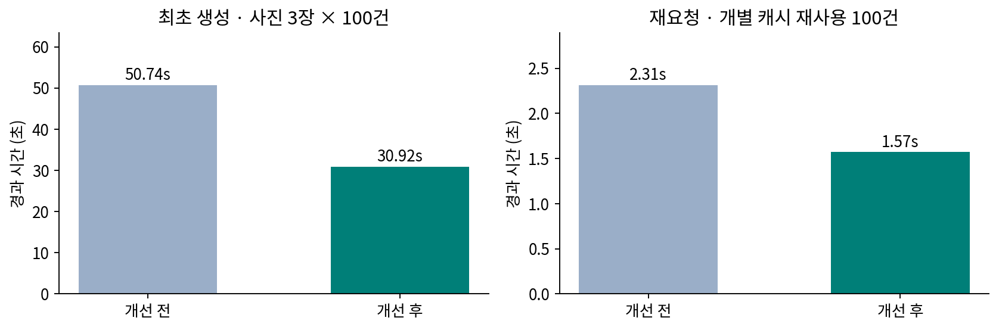
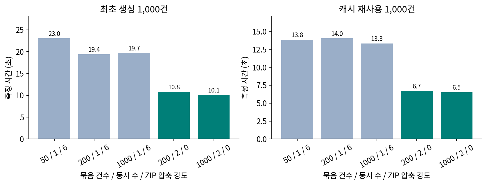

# HWPX 대량 생성 성능 개선 — 2026-11-12

기본 처리 방식을 **50건 순차 → 200건·동시2건**으로 변경했다. 활성 묶음 사이 대기는 1초에서 100ms로 줄이고 유휴 DB 확인은 최대 초당1회로 유지했다. HWPX 안의 JPEG와 HWPX를 담는 ZIP에 불필요한 재압축을 줄였다. 큰 원본 사진은 축소 디코딩한 뒤 최대1280px로 출력한다.

[공유용 PDF](report.pdf) · [단독 HTML](report.html) · [전후 원시 결과](before.json) / [후](after.json) · [설정 비교 원시 결과](batch-matrix.json) · [실행 검증](regression.json)

## 1. 실제 기존 코드와 개선 코드 비교

기준 develop `95ed14d`, 구현 `86ad189`. 같은 PerformanceBaselineTest를 수정하지 않고 전후 각1회 실행했다. 수용가2만 건, START1만/END5천 건을 가진 임시 PostgreSQL17에서 사진 있는100건을 생성했다. 한 건당 합성 JPEG3장(각1600×1200, 362,834바이트), 총300장이다. CPU할당2개/메모리8GiB/Java21.0.13/힙768MiB/풀10개. 실제 사진·운영 DB·R2는 사용하지 않았다.

| 작업 | 개선 전 | 개선 후 | 경과 시간 감소 |
| --- | ---: | ---: | ---: |
| 최초 생성100건·사진300장 | 50.74초 | 30.92초 | 39.1% |
| 동일 내용 재요청100건 | 2.31초 | 1.57초 | 32.1% |



수치는 요청 생성부터 연속 tick 호출로 READY까지의 서비스 실행 시간이다. 실제 스케줄 대기, HTTP/인증/Cloudflare, 대기열·다운로드는 제외한다. 표본은 작업당1회이므로 통계적 p95/평균 성과로 주장하지 않는다. 원시 JSON의 단일 표본 p50/p95는 단일 실행값일 뿐이다. 렌더 시간은 병렬 작업의 시간 합이라 경과 시간과 직접 비율을 비교하지 않는다. 이 결과는 여러 변경을 함께 적용한 효과이며 각각의 기여도를 분리한 실험은 아니다.

전후 모두 신규 렌더100회/사진 읽기300회/객체 저장105회이며, 재요청은 렌더0회다. 기존 개별 HWPX 재사용을 유지한다. 사진 있는 묶음은 약16MiB에서 분할되어 건수 상한200을 모두 채우지 않을 수 있다.

## 2. 50 / 200 / 1,000건 비교

아래는 **모든 설정에 개선 후 렌더러를 공통 사용한 설정 비교**다. 기존 코드 자체와의 전후 비교가 아니다. 사진 없는 합성1,000건, 별도 임시 PostgreSQL17, 파일 저장소 GET/PUT마다 인위적10ms 지연을 넣었다. 실제 R2 지연 분포·네트워크·대역폭은 재현하지 않는다. 워밍업50건 후 설정별 최초/캐시 재요청을 각1회 실행했다. 설정별 사업명을 달리하여 최초 생성 캐시를 분리했다. 순서가 고정되어 JIT/GC/공유 환경 부하가 영향을 줄 수 있다.

| 건수 / 동시 / ZIP 강도 | 단계 | 실제 측정 | 내부 묶음 수 | 추가 저장량 | 스케줄 대기 모델(측정 아님) |
| --- | --- | ---: | ---: | ---: | ---: |
| 50 / 1 / 6 | 최초 | 23.04초 | 20 | 24.49MiB | +19.0초 |
| 50 / 1 / 6 | 캐시 | 13.84초 | 20 | 12.01MiB | +19.0초 |
| 200 / 1 / 6 | 최초 | 19.43초 | 5 | 24.49MiB | +4.0초 |
| 200 / 1 / 6 | 캐시 | 14.03초 | 5 | 12.00MiB | +4.0초 |
| 1000 / 1 / 6 | 최초 | 19.71초 | 1 | 24.49MiB | +0.0초 |
| 1000 / 1 / 6 | 캐시 | 13.32초 | 1 | 12.00MiB | +0.0초 |
| 200 / 2 / 0 | 최초 | 10.79초 | 5 | 25.08MiB | +0.4초 |
| 200 / 2 / 0 | 캐시 | 6.70초 | 5 | 12.60MiB | +0.4초 |
| 1000 / 2 / 0 | 최초 | 10.06초 | 1 | 25.08MiB | +0.0초 |
| 1000 / 2 / 0 | 캐시 | 6.55초 | 1 | 12.60MiB | +0.0초 |



대기 모델은 `(묶음 수−1)×대기`이며, 순차 설정은1초, 동시2건 설정은0.1초를 가정한다. 최초 기동·유휴 확인·큐 대기·정리 비용은 포함하지 않았다. 측정 시간에 이 모델을 섞어 실측 개선률로 표시하지 않는다. 추가 저장량은 해당 요청이 새로 만든 개별 캐시와 ZIP의 합이며 원본 사진 용량은 아니다. 재요청도 요청별 ZIP은 새로 보관한다. ZIP 무압축은 CPU 시간을 줄이는 대신 특히 사진 없는 문서의 저장량이 늘어난다.

## 3. 1,000건을 기본으로 하지 않은 이유

건수를 늘려도 개별 문서의 사진 읽기·변환·저장 횟수는 줄지 않는다. 특히 사진이 있는 문서는 건수 상한보다 약16MiB ZIP 임계값에 먼저 도달한다. 따라서 단순1,000건보다 제한된 동시 처리와 사진/압축 비용 감소를 먼저 적용했다. 기본200건은 완료 상태 저장 주기·재시작 시 다시 묶을 범위·메모리와 처리량 사이의 절충이다. 환경에 따라 최대1,000까지 조정할 수 있다. 이 측정으로 모든 운영 환경에서200이 최적이라고 주장하지 않는다.

## 4. 동작 보존과 운영 설정

- 전체 ZIP 하나 다운로드, 수용가 순서, 최대1280px/EXIF 방향, 기존 양식·사진 슬롯은 유지한다. 원본 사진은 변경하지 않는다.
- 기존 card-2 캐시는 유효하여 버전을 올리지 않았다. DB 스냅샷·사진 키·사업명·양식 버전 기반 해시와 다운로드 직전 변경 검사는 유지한다.
- 동시 실행은 기본2건/최대4건이며 전체1,000건을 동시에 제출하지 않는다. 작업 간 DB advisory lock은 유지한다. 취소/삭제 시 진행 중 작업 완료를 기다린 후 잠금을 해제하여 늦은 업로드와 정리의 경쟁을 막는다.
- 완료 묶음 이후 재개, 만료·공유 캐시 보존, ADMIN/CSRF/소유자 권한은 기존 정책을 유지한다. Redis/SQS 및 새 인프라/마이그레이션은 없다.
- `DOCUMENT_BATCH_SIZE=200`, `DOCUMENT_PARALLELISM=2`, `DOCUMENT_ZIP_COMPRESSION_LEVEL=0`, `DOCUMENT_WORKER_DELAY_MS=100`이 기본이다. 기존 처리량 설정은50/1/6/1000. 새 JAR 배포 시 기본값 적용, 선택 설정 변경 시 서비스 재시작이 필요하다.
- 작은 EC2는 동시1건부터 확인하고 CPU·힙·GC·R2 제한을 관측한다. `HWPX batch` 로그의 생성/캐시 적중/읽기/렌더/업로드/ZIP 시간으로 운영 병목을 분리할 수 있다. WorkerMs는 병렬 시간 합이다.

## 5. 검증과 남은 한계

신규 동작 테스트3개를 기존 구현에서 실패시킨 뒤 최소 구현·리팩터링했다. 최종 `test bootJar`는94개 실패/오류/skip0이며, 별도 performanceBaseline 전후 및1,000건 설정 비교가 통과했다. 51건 초과 기본 처리·동시 실행·취소 후 늦은 쓰기 방지·약16MiB 분할·순서·ZIP/JPEG 형식·큰 이미지 축소 디코딩·유휴 폴링을 검증했다. 기존 hwpxlib 독립 읽기 및 보안/변경/정리 회귀도 포함한다.

실제18,000건 전체 생성, 운영 R2 속도·비용/EC2 메모리, 한글 프로그램 인쇄, 대용량 Cloudflare 다운로드는 이번에 실행하지 않았다. 로컬100건/사진 없는1,000건으로 운영 완료 시간을 선형 환산하지 않는다. 저장량 표는 합성 자료의 결과이며 운영 저장비 추정치가 아니다. 최초 전후1쌍·설정당1회이므로 반복 실험 및 운영 관측이 후속 과제다.

## 재현과 협업 기록

Java21·Docker 사용 가능 환경에서 다음 명령을 각각 실행한다(테스트는 임시 PostgreSQL과 합성 자료만 사용).

```bash
bash backend/gradlew -p backend test bootJar --no-daemon
bash backend/gradlew -p backend performanceBaseline --tests '*PerformanceBaselineTest.baseline' --no-daemon
bash backend/gradlew -p backend performanceBaseline --tests '*DocumentBatchPerformanceTest*' --no-daemon
python docs/performance/2026-11-12-hwpx/build_report.py --pdf
```

각 성능 태스크는 `backend/build/performance/`에 결과를 만든다. 전후 결과는 각 커밋에서 실행 후 before.json/after.json으로 복사하고 설정 비교 결과는 document-batches/results.json에서 batch-matrix.json으로 복사한다. 테스트 실행에는 해당 환경의 JAVA_HOME/DOCKER_HOST/Gradle 캐시 설정이 필요할 수 있다. 보고서 재생성 스크립트는 보관된 JSON을 읽으며 성능 테스트를 다시 실행하지 않는다.

사용자가 성능 개선 목표·업무 정책을 결정했고 Codex가 코드 검토, 실패 테스트, 구현, 합성 계측, 문서 정리를 지원했다. 측정값과 예측을 구분하고 PR로 검토할 수 있게 제공한다.
