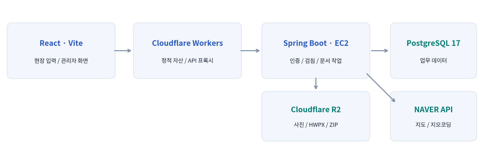
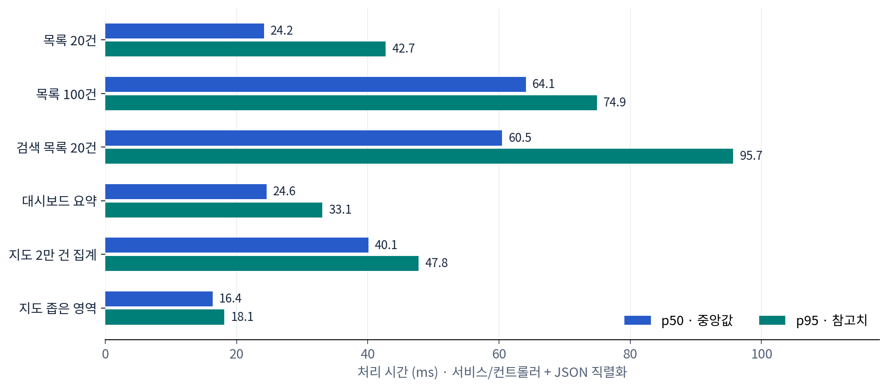
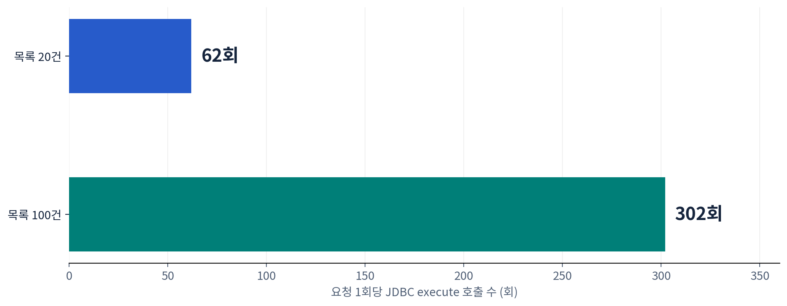
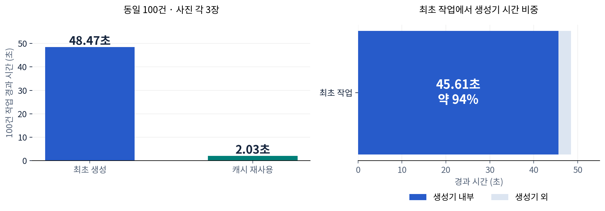

# Field Work Manager — 프로젝트 개요와 성능 기준 측정

측정일: 2026-11-10 · 상태: 개선 전 기준선 · 모든 데이터는 가상 데이터

## 01 / PROJECT OVERVIEW — 수도 검침 업무의 디지털화와 성능 기준 수립

Field Work Manager · 약 2만 수용가의 현장 검침·사진·지도·정산·문서 출력을 연결하는 업무 시스템

> **이번 기록의 범위 — 개선 전 기준선**
> 2026년 11월 10일, 가상 수용가 20,000건으로 실제 코드를 실행해 조회와 문서 생성 비용을 측정했다. 성능 개선은 아직 적용하지 않았으며, 이후 개선 결과를 비교할 기준을 보존했다.

### 업무와 기술 구성

관리자가 Excel로 대상 수용가를 등록하고 주소를 좌표로 변환한다. 조사자는 지도·목록에서 현장을 찾아 START/END 검침, 사진, 특이사항을 기록한다. 관리자는 이력·실적·정산을 확인하고 수용가별 HWPX와 ZIP을 내려받는다. 예상 사용자는 약 20명이다.

그림 1. 현재 코드와 배포 구성을 요약한 구조도. 실제 운영 화면 캡처가 아니다.

| 구분 | 구성 |
| --- | --- |
| 프론트엔드 | React / TypeScript / Vite / Cloudflare Workers |
| 백엔드·DB | Java 21 / Spring Boot / PostgreSQL 17 / Flyway |
| 파일·외부 연동 | 비공개 R2 / NAVER 지도·지오코딩 / HWPX |
| 배포·검증 | GitHub Actions → AWS EC2 / JUnit 5 + Testcontainers |

### 측정 질문

사용자가 체감하는 대량 문서 생성 지연과 조회 비용을 설명할 수 있는가? Redis나 메시지 시스템 도입 전에, 현재 구조에서 실제로 비용이 발생하는 위치를 확인하고자 했다.

## 02 / MEASUREMENT DESIGN — 운영 데이터 없이 재현 가능한 측정

| 항목 | 조건 |
| --- | --- |
| 대상 코드 | develop · 4768ab313d2e814baf20f200263071db2441db97 |
| 실행 환경 | Java 21.0.13 / CPU 할당 2개 / 환경 메모리 한도 8GiB |
| JVM·DB | 힙 최대 768MiB / PostgreSQL 17-alpine / Hikari 풀 10개 |
| 가상 데이터 | 수용가 20,000 / START 10,000 / END 5,000 |
| 사진 시나리오 | 100개 현장 × 3장 / JPEG 1600×1200 / 장당 362,834바이트 |
| 파일 저장소 | 로컬 파일 / 추가 지연 0 / 실제 R2 호출 없음 |

### 측정 절차

- 독립 Testcontainers PostgreSQL에 기존 Flyway를 적용하고 가상 데이터를 생성했다.
- 목록·요약은 읽기 트랜잭션으로 실행하고, 지도 컨트롤러와 JSON 직렬화까지 계측했다.
- 조회별 2~3회 예열 후 10~20회 측정했다. JDBC execute 횟수와 경과 시간을 기록했다.
- 문서 100건의 최초 생성과 동일 조건 재요청을 각각 1회 측정했다. 사진 없는 생성기는 별도로 100회 측정했다.
- 일반 회귀 테스트 64개가 실패·오류 없이 통과했다. 측정 후 임시 DB와 생성 파일을 정리했다.

> **운영 응답시간 또는 최대 처리량을 의미하지 않는다**
> HTTP·인증 필터·Cloudflare·브라우저·실제 R2/NAVER를 제외한 개발 환경 실험이다. 짧은 표본의 p95는 참고치이며, 운영 SLO나 최대 RPS로 사용하지 않는다. CPU 사용률·최대 RSS·GC 프로파일도 이번에는 수집하지 않았다.

### 재현 가능한 증거

측정 코드, 원시 JSON, 실행 계획을 함께 보관했다. 다음 개선에서는 같은 데이터·예열·반복 횟수·환경으로 비교한다. 결과가 달라지면 측정 조건 변경과 코드 변경을 구분해 기록한다.

## 03 / READ PATH — 목록의 행별 추가 조회를 확인하다

그림 2. 조회별 처리 시간. 10~20회 표본의 p50/p95이며 운영 HTTP 지연은 제외했다.

| 시나리오 | 표본 | p50 / p95 | SQL/요청 |
| --- | --- | --- | --- |
| 목록 20건 | 20 | 24.20 / 42.74 ms | 62 |
| 목록 100건 | 10 | 64.09 / 74.92 ms | 302 |
| 검색 목록 20건 | 10 | 60.48 / 95.69 ms | 62 |
| 대시보드 요약 | 20 | 24.60 / 33.06 ms | 5 |
| 지도 2만 건 집계 | 20 | 40.08 / 47.75 ms | 1 |
| 지도 좁은 영역 | 20 | 16.35 / 18.14 ms | 1 |

### 조회 시간이 짧아도 쿼리 증가 구조는 남아 있다

목록 20건에서 62회, 100건에서 302회의 JDBC 실행이 관측됐다. 코드를 확인하면 전체 건수와 ID 목록 조회 이후 각 현장의 기본정보·사진·검침을 다시 조회한다. 측정한 목록 경로에서 SQL 수는 2 + 3 × 반환 건수로 증가한다.

동시성 10으로 목록 20건을 총 100회 호출했을 때 요청 p50은 100.67ms, p95는 195.96ms였다. 단일 요청보다 지연이 커졌지만, 이 제한된 실험만으로 운영에서 수용 가능한 사용자 수를 판단하지 않는다.

## 04 / QUERY EVIDENCE — 캐시 도입에 앞서 조회 구조를 점검하다

그림 3. 목록 반환 건수가 5배 증가하면 JDBC 실행 수는 62회에서 302회로 증가한다.

| 실행 계획 대상 | 관측 | 단회 실행 시간 |
| --- | --- | --- |
| 목록 첫 20개 ID | 관리번호 인덱스 Index Only Scan | 0.033ms |
| 네 열 부분 문자열 검색 count | Seq Scan / 20,000행 검사 | 24.593ms |
| 전체 영역 지도 집계 | Seq Scan / 20,000행 처리 | 22.144ms |
| 좁은 영역 지도 ID | Seq Scan + 정렬 / 일치 25행 | 3.422ms |

실행 계획 시간은 단회 EXPLAIN ANALYZE 값이며 서비스 p50/p95와 다른 측정이다. 좁은 영역 지도 계획은 검침 상태 하위 쿼리를 제외한 좌표·정렬 부분만 측정했다. 좌표는 규칙적으로 분포한 합성 데이터다.

### 현재 근거로 세운 개선 가설 — 아직 미적용

- 목록 전용 projection 또는 관련 정보 일괄 조회로 행별 추가 SQL을 줄이면 DB 왕복과 동시 조회 비용을 낮출 수 있다.
- 부분 문자열 검색은 pg_trgm, 좌표 조회는 적절한 좌표·공간 인덱스를 후보로 검증할 수 있다. 전체 스캔이라는 이유만으로 인덱스가 항상 유리한 것은 아니다.
- 지도 캐시는 화면 좌표 그대로보다 재사용 가능한 타일·격자 키를 먼저 검토한다. 캐시 무효화와 오래된 상태의 노출도 함께 설계해야 한다.

## 05 / DOCUMENT PIPELINE — 사진 처리와 캐시 재사용을 분리해서 측정하다

그림 4. 동일 문서 100건 최초 생성과 기존 HWPX 캐시 재사용 비교. 각각 1회 측정이며 개선 전후 비교가 아니다.

| 측정 항목 | 최초 생성 | 동일 조건 재요청 |
| --- | --- | --- |
| 100건 전체 경과 | 48.47초 | 2.03초 |
| 생성기 호출 / 합산 시간 | 100회 / 45.61초 | 0회 / 0초 |
| 저장소 GET / PUT | 300 / 105회 | 100 / 5회 |
| JDBC execute | 800회 | 600회 |

최초 작업 시간의 약 94%가 생성기 내부에서 관측됐다. 이 시간은 이미지 처리, 문서 XML 구성, 압축 등을 포함한다. 이미지 축소만이 원인이라고 확정하지 않았다. 로컬 파일 I/O와 실제 R2 지연은 다르다.

재요청에서 생성기 호출이 0회인 것으로 기존 문서 캐시의 재사용을 확인했다. 캐시 키는 문서 생성기 버전·제목·데이터 스냅샷의 해시를 사용한다. 재요청에도 캐시 파일 읽기와 ZIP 생성, DB 작업은 발생했다.

> **사진 없는 문서는 별도 실험**
> 사진 없는 생성기만 5회 예열 후 100회 측정했을 때 건당 p50 6.42ms, p95 18.01ms였다. DB·저장소·ZIP이 제외된 값이므로 위 100건 작업과 직접 비교하거나 19,000건 완료 시간으로 환산하지 않는다.

문서 작업은 tick을 연속 호출했다. 실제 1초 스케줄러 대기, 기존 작업 대기열, 최종 다운로드 전송은 제외했다. 100건 작업 각각의 단일 관측값을 p95나 안정적인 평균으로 표현하지 않는다.

## 06 / NEXT EXPERIMENT — 개선 전후를 같은 기준으로 남기는 방법

| 우선순위 | 후속 실험 | 검증할 지표 |
| --- | --- | --- |
| 1 · 목록 | 상세 재조회 → 목록 전용/일괄 조회 | SQL/요청, p50/p95, 동시 조회 지연 |
| 2 · 문서 | 생성기 프로파일링·중복 작업/ZIP 재사용 | 전체 시간, 생성기 시간, GET/PUT, 최대 메모리 |
| 3 · 검색·지도 | 인덱스 후보 비교와 실행 계획 확인 | 읽은 행/버퍼, 조회 시간, 쓰기 비용 |
| 4 · 인프라 | 필요가 확인되면 Redis·작업 워커 분리 | 캐시 적중률, 무효화, 큐 지연·복구 |

메시지 시스템은 재시도·작업 지속성·자원 분리에 도움이 될 수 있으나 생성기 연산을 자체적으로 빠르게 하지는 않는다. 현재 측정만으로 Redis나 SQS를 필수로 결정하지 않았다.

### 후속 개선 비교표

| 지표 | 현재 기준 | 개선 후 |
| --- | --- | --- |
| 목록 20건 · SQL/요청 | 62회 | 미측정 |
| 목록 20건 · p50/p95 | 24.20 / 42.74ms | 미측정 |
| 목록 100건 · SQL/요청 | 302회 | 미측정 |
| 사진 포함 최초 100건 | 48.47초 · 1회 관측 | 미측정 |
| 동일 조건 재요청 100건 | 2.03초 · 1회 관측 | 미측정 |

### 포트폴리오에 사용할 수 있는 요약

약 2만 수용가를 관리하는 현장 검침 시스템에서 가상 데이터와 독립 PostgreSQL을 사용한 성능 기준을 수립했다. 응답시간뿐 아니라 JDBC 실행 수와 문서 생성·저장소 비용을 분리해 측정했다. 목록의 행별 추가 조회와 사진 포함 문서 생성기의 비용을 확인하고, 캐시 재사용 효과와 미측정 운영 조건을 구분해 후속 개선의 우선순위를 정했다.

### 증거와 후속 기록

상세 측정 보고서: docs/PERFORMANCE_BASELINE_2026-11-10.md · 원시 결과: docs/performance/2026-11-10/ · 측정 코드: backend/src/test/java/com/meter/fieldwork/performance/PerformanceBaselineTest.java

후속 기록은 IMPROVEMENT_LOG.md를 사용한다. 개선 커밋, 동일 조건 여부, 실행 명령, 원시 결과, 회귀 테스트, 전후 그래프를 함께 남기고 현재 기준 파일은 보존한다. 운영 R2·HTTP 전체 경로·19,000건 생성·장시간 부하는 아직 측정하지 않았다.
